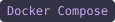
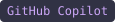
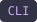
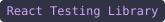

<div align="center">
  
  <h3>I'm Danielle Roslund.</h3>
  <p><strong>Software Developer</strong> | Full Stack · AI · Security</p>
  <p><samp>Building software. Exploring systems. &lt;/&gt;</samp></p>
  <a href="https://www.linkedin.com/in/danielle-roslund/"></a>
  <span> · Malmö, Sweden</span>
</div>


##  01 / About me

I'm a software developer with a background in Java and full-stack development. I enjoy building reliable, maintainable software and understanding how systems work beneath the surface.

My experience includes REST APIs, database integration and migrating a large-scale application from AngularJS to React. With over 10 years in customer service and sales before transitioning into tech, I bring a user-focused approach to development and collaboration.

```typescript
const developer = {
  role: "Software Developer",
  interests: ["Gaming", "Music", "Software Development", "Cybersecurity", "AI"],
  skills: ["Java", "Spring Boot", "React", "Python", "TypeScript"],
  mindset: "Always learning",
  openToWork: true
};
```

##  02 / Selected work

###  [Customer Service Portal](https://github.com/danielleven/kundportal-ai-native-development-grupp-1)

*Collaborative project · Backend & full-stack development*

A full-stack application for managing customer support tickets. I established the project foundation, integrated the frontend, backend and database, and implemented REST APIs, validation, database migrations and automated backend tests.

       

My contributions: [Project foundation](https://github.com/danielleven/kundportal-ai-native-development-grupp-1/pull/18) · [Ticket API](https://github.com/danielleven/kundportal-ai-native-development-grupp-1/pull/19)

###  [Multi-Agent AI Reviewer](https://github.com/danielleven/kundportal-ai-native-development-grupp-1/pull/28)

*Developer tooling · Individual contribution to the Customer Service Portal*

Designed a reusable GitHub Copilot workflow with a main agent and three specialized subagents for structured reviews of requirements, code and tests.

  


###  [Static Site Generator](https://github.com/danielleroslund/static_site_generator)

*Personal project · Built from scratch*

A Python static site generator that converts Markdown into HTML websites using a custom parsing and rendering pipeline.

  

[Live demo](https://danielleroslund.github.io/static_site_generator/)

###  [AI Coding Agent](https://github.com/danielleroslund/ai-agent)

*Personal project · AI integration*

A lightweight Python coding agent exploring LLM integration, prompt engineering and developer tooling.

  


##  03 / Technologies & tools

**Languages & frameworks**


**Data, testing & DevOps**


    


##  04 / Learning & growing

###  [AI Native Development](https://www.technigo.io/courses/ai-native-development)
*Technigo · 2026*

AI agents, specification-driven development and AI-assisted testing.

###  [Cybersecurity – Secure Digital Solutions](https://www.technigo.io/courses/cybersakerhet-bygg-sakra-digitala-losningar)
*Technigo · 2026–2027*

Secure coding, vulnerability analysis and risk assessment.

###  [Java Development](https://nackademin.se/utbildningar/javautvecklare-distans/)
*Nackademin · Graduated 2024*

Object-oriented programming, backend and full-stack development.

###  Featured in Technigo Stories

**[My journey into AI Native Development](https://www.technigo.io/stories/danielle-studerar-ai-native-development)** · Interview (Swedish)

I shared my experience with AI-assisted development and the evolving role of software developers.

##  05 / Let's connect

I'm open to frontend, backend and full-stack opportunities. Always happy to connect, collaborate and explore new ideas.

[](https://www.linkedin.com/in/danielle-roslund/)

---

<div align="center">
  
</div>
