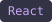
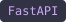
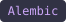
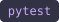
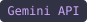
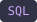

<div align="center">
  

  <h1>Hi, I'm Danielle!</h1>

  <p><strong>Software Developer</strong> · Full Stack · AI · Cybersecurity</p>

  <p><samp>I like building things and figuring out how they work.</samp></p>

  Malmö, Sweden · <a href="https://www.linkedin.com/in/danielle-roslund/">LinkedIn</a>
</div>


##  01 / About me

I'm a software developer with a background in Java and full-stack development. I enjoy solving problems, experimenting with new technologies and exploring different approaches to software development.

My experience includes REST APIs, database integration and migrating a large-scale application from AngularJS to React. I'm particularly interested in software architecture, AI and cybersecurity.

Before transitioning into tech, I spent over 10 years working in customer service and sales, which has shaped my user-focused approach to software development.

I'm currently expanding my skills in AI Native Development and Cybersecurity at Technigo. I recently shared my experience with AI-assisted development and the evolving role of software developers in an interview with [Technigo Stories](https://www.technigo.io/stories/danielle-studerar-ai-native-development) (in Swedish).

`GET /profile`

```typescript
const developer = {
  interests: ["gaming", "music", "software development"],
  skills: ["java", "spring boot", "react", "python", "typescript"],
  currentlyLearning: ["AI Native Development", "Cybersecurity"],
  currentTitle: "Software Developer",
  openToWork: true
};
```
<details>
<summary><strong>When I'm not coding</strong></summary>

- Playing WoW Forever
- Playing Call of Duty: MW4
- Leveling my Ironman in RuneScape
- Listening to music ([currently on repeat](#currently-on-repeat))

</details>

##  02 / Selected work

###  [Customer Service Portal](https://github.com/danielleven/kundportal-ai-native-development-grupp-1)

*Collaborative project · Backend & full-stack development*

A full-stack application for managing customer support tickets.

**My contributions:** I established the technical foundation, integrated the frontend, backend and database, and implemented REST APIs, validation, database migrations and automated backend tests.

       

<details>
<summary><strong>Explore my contributions</strong></summary>

**[PR #18 · Project foundation](https://github.com/danielleven/kundportal-ai-native-development-grupp-1/pull/18)**

Project structure, development environment, database configuration and integration.

**[PR #19 · Ticket API](https://github.com/danielleven/kundportal-ai-native-development-grupp-1/pull/19)**

REST endpoints, input validation, data persistence and automated backend tests.

**[PR #28 · Multi-Agent AI Reviewer](https://github.com/danielleven/kundportal-ai-native-development-grupp-1/pull/28)**

A reusable AI-assisted review workflow for requirements, implementation and testing.

</details>

###  [Multi-Agent AI Reviewer](https://github.com/danielleven/kundportal-ai-native-development-grupp-1/pull/28)

*Developer tooling · Individual contribution to the Customer Service Portal*

Designed a reusable GitHub Copilot workflow with a main agent and three specialized subagents for structured reviews of requirements, code and tests.

  

###  [Static Site Generator](https://github.com/danielleroslund/static_site_generator)

*Personal project · Built from scratch*

A Python static site generator that converts Markdown into HTML websites using a custom parsing and rendering pipeline.

  

[Live demo](https://danielleroslund.github.io/static_site_generator/)

###  [AI Coding Agent](https://github.com/danielleroslund/ai-agent)

*Personal project · AI integration*

A lightweight Python coding agent exploring LLM integration, prompt engineering and developer tooling.

  

##  03 / Toolbox

**Languages**




**Frameworks & libraries**


**Data & persistence**


**Testing & quality**


 

**DevOps & tooling**


**AI & developer tooling**

   

<details>
<summary><strong>Core competencies</strong></summary>

- **Software development:** Full-stack development, REST APIs and database integration.
- **Software quality:** Automated testing, test-driven development and maintainable code.
- **AI-assisted development:** AI agents, specification-driven development and developer tooling.
- **Cybersecurity:** Secure coding, vulnerability analysis and risk assessment.
- **DevOps:** CI/CD, containerization and version control.

</details>

##  04 / Learning & growing

###  [AI Native Development](https://www.technigo.io/courses/ai-native-development)

*Technigo · 2026*

AI agents, specification-driven development and AI-assisted testing.

###  [Cybersecurity: Secure Digital Solutions](https://www.technigo.io/courses/cybersakerhet-bygg-sakra-digitala-losningar)

*Technigo · 2026–2027*

Secure coding, vulnerability analysis and risk assessment.

###  [Java Development](https://nackademin.se/utbildningar/javautvecklare-distans/)

*Nackademin · Graduated 2024*

Object-oriented programming, backend and full-stack development.

###  Featured in Technigo Stories

[My journey into AI Native Development](https://www.technigo.io/stories/danielle-studerar-ai-native-development) · *Interview (Swedish)*

##  05 / Let's connect

I'm always happy to exchange ideas, collaborate on interesting projects or talk about anything from software development to gaming and music.

Currently open to frontend, backend and full-stack opportunities.

<div align="center">
  <a href="https://www.linkedin.com/in/danielle-roslund/"><strong>LinkedIn</strong></a>

  <p><i>Thanks for stopping by! ♡</i></p>
</div>

---

<a name="currently-on-repeat"></a>

<div align="center">
  
</div>
